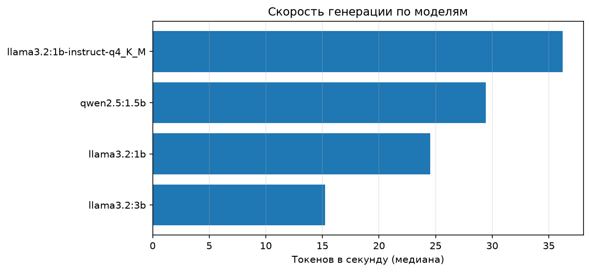
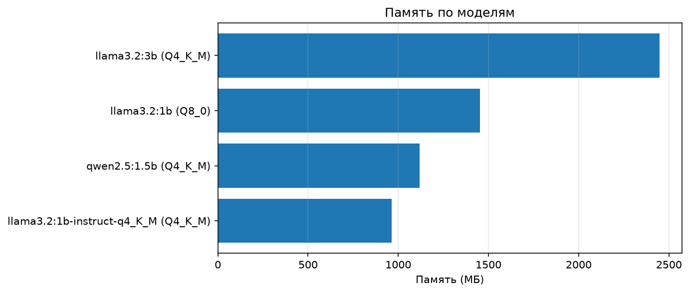
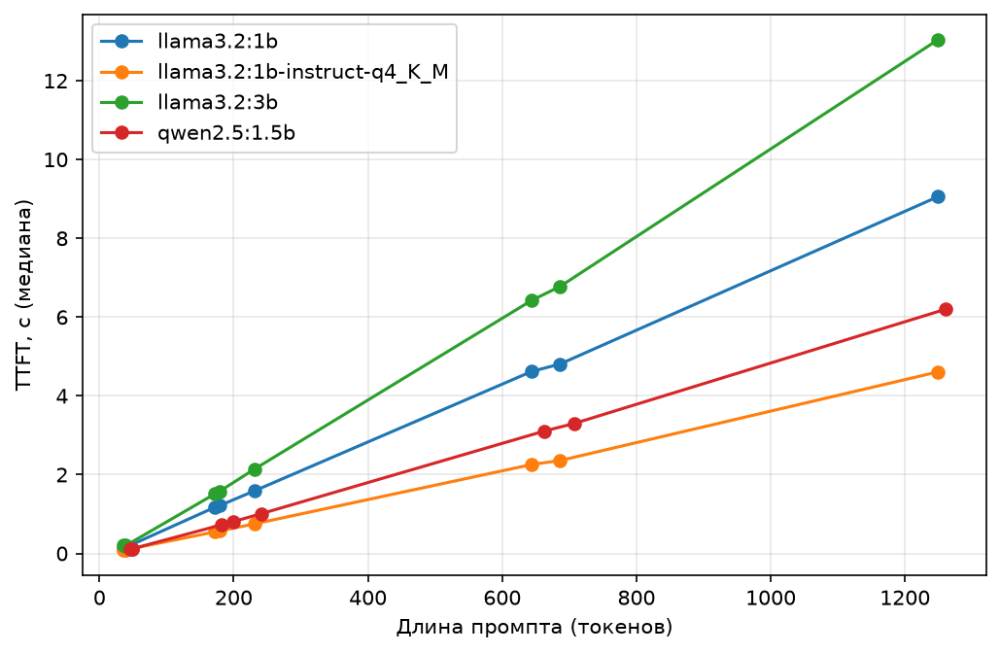
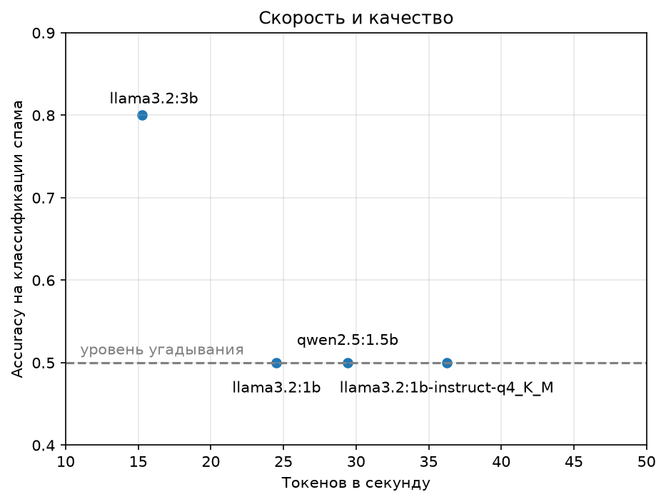

# Бенчмарк локальных LLM на CPU и мини-агент: скорость, память, качество, русский и английский

Небольшое исследование, как ведут себя маленькие языковые модели, запущенные локально через Ollama на обычном ноутбуке без видеокарты. Я измеряла производительность (время до первого токена, скорость генерации, память), качество на задаче классификации спама и разницу между русским и английским языками. Кроме этого я собрала мини-агента с вызовом функций (tool calling) и проверила на нём две модели: `llama3.2:3b` и `bonsai-2:9b`.

**Главный вывод:** на моём железе скорость почти полностью определяется размером модели в памяти, а из четырёх проверенных моделей различает спам и не спам только самая большая (`llama3.2:3b`). Остальные на этом промпте работают на уровне угадывания. Про агентов: простой запрос к данным решают обе модели, а отказ от лишнего вызова функции, цепочка из двух вызовов и честное «данных нет» почти без подсказок получаются только у Bonsai 9B, но это занимает время (около 32 с вместо 9 с).

## Что внутри

- Бенчмарк скорости и памяти четырёх моделей.
- Сравнение квантизаций Q4_K_M и Q8_0 на одной и той же модели.
- Оценка качества классификации спама на 40 письмах.
- Мини-исследование «русский против английского».
- Мини-агент с вызовом функций и тест из 10 вопросов на двух моделях.
- Упаковка бенчмарка в Docker.

## Окружение

- Windows, 16 ГБ ОЗУ, только CPU.
- Ollama, запросы через HTTP API (`/api/generate`, `/api/chat`, `/api/ps`).
- Python, pandas, requests, matplotlib.
- Модели:

| Модель | Квантизация |
|---|---|
| `llama3.2:1b` | Q8_0 |
| `llama3.2:1b-instruct-q4_K_M` | Q4_K_M |
| `llama3.2:3b` | Q4_K_M |
| `qwen2.5:1.5b` | Q4_K_M |
| `bonsai-2:9b` (только в тесте агента) | троичные веса {−1, 0, +1} |

## 1. Скорость и память

**Методика**

- Перед замерами делается прогрев модели, каждый промпт запускается по 5 раз.
- В начало каждого промпта добавляется уникальный префикс, чтобы кеширование префикса (prefix caching) не искажало TTFT.
- Температура 0, `seed` 42, ограничение длины ответа (`num_predict`).
- Память берётся из `/api/ps`.
- Измеряются: TTFT (время до первого токена, секунды), ITL (задержка между токенами, миллисекунды; среднее и 95-й процентиль), скорость генерации (токенов в секунду).
- Везде приводятся медианы, а не средние, чтобы случайные выбросы не меняли картину.

**Результаты**

| Модель | Память, МБ | Токенов/с | TTFT медиана, с | TTFT p95, с | ITL медиана, мс |
|---|---|---|---|---|---|
| `llama3.2:1b` (Q8_0) | 1453 | 24,5 | 1,21 | 9,04 | 41,0 |
| `llama3.2:1b-instruct-q4_K_M` | 963 | 36,2 | 0,57 | 4,60 | 27,7 |
| `llama3.2:3b` (Q4_K_M) | 2449 | 15,3 | 1,61 | 13,01 | 65,9 |
| `qwen2.5:1.5b` (Q4_K_M) | 1119 | 29,4 | 0,80 | 6,19 | 34,3 |




**Наблюдения**

- Скорость генерации на CPU примерно обратно пропорциональна размеру модели в памяти: инференс упирается в пропускную способность памяти.
- **Квантизация.** Q4_K_M против Q8_0 для одной и той же `llama3.2:1b`: память меньше на 34 % (963 против 1453 МБ), скорость выше в 1,5 раза, TTFT ниже в 2,1 раза.
- **TTFT растёт почти линейно с длиной промпта**, поэтому большой p95 объясняется самыми длинными промптами (около 1250 токенов), а не шумом. Наклон зависит от модели: самый быстрый обрабатывает промпт примерно в 2,5–3 раза быстрее самого медленного.



## 2. Качество: классификация спама

**Данные и постановка**

- 40 писем из публичного набора писем (спам и фишинг против обычных), 20 спама и 20 не спама, случайная выборка с фиксированным `random_state=42`, длина от 30 до 150 слов.
- Модель должна ответить одним словом: `SPAM` или `NOT_SPAM`. Температура 0, ответ ограничен несколькими токенами.
- Метрики: accuracy, precision, recall.

**Результаты**

| Модель | Accuracy | Precision | Recall |
|---|---|---|---|
| `llama3.2:1b` (Q8_0) | 0,50 | нет предсказаний SPAM | 0,00 |
| `llama3.2:1b-instruct-q4_K_M` | 0,50 | нет предсказаний SPAM | 0,00 |
| `llama3.2:3b` | 0,80 | 0,75 | 0,90 |
| `qwen2.5:1.5b` | 0,50 | 0,50 | 1,00 |



**Наблюдения**

- Обе модели `llama3.2:1b` всегда отвечают `NOT_SPAM`, `qwen2.5:1.5b` всегда отвечает `SPAM`. Для сбалансированной выборки это ровно 0,5 accuracy, то есть уровень угадывания.
- Только `llama3.2:3b` реально различает письма.
- **Эксперимент с порядком вариантов.** Я поменяла порядок вариантов ответа в промпте. У маленьких моделей наблюдалось смещение к последнему названному варианту, то есть их ответ зависит от формулировки, а не от письма.
- Даже при температуре 0 и фиксированном `seed` первый запрос с данным промптом иногда даёт другой текст, чем повторные (вероятно, из-за кеша промпта). Поэтому «5 повторов» нужно читать как «1 + несколько одинаковых».

**Выбор модели для этой задачи.** На этом наборе осмысленный вариант один: `llama3.2:3b`. Для классификации ответ очень короткий, поэтому важнее TTFT, чем токены в секунду: у 3b это около 1,6 с на запрос против 0,6 с у самой быстрой модели.

## 3. Русский и английский

**Методика**

- 36 коротких заданий: 18 на русском и 18 на английском, по три типа (ДА/НЕТ на факты, ДА/НЕТ на арифметику, один ответ-слово на географию). ДА и НЕТ поровну, поэтому «всегда одно и то же» даёт 0,5.
- 4 длинных задания (две темы на каждом языке), ответ ограничен 200 токенами, по 3 запуска. Смотрю скорость, символов на токен и долю кириллицы в ответе.

**Закрытые вопросы (ДА/НЕТ), accuracy**

| Модель | English | Русский |
|---|---|---|
| `llama3.2:1b` | 0,50 | 0,50 |
| `llama3.2:1b-instruct-q4_K_M` | 0,50 | 0,50 |
| `llama3.2:3b` | 0,75 | 0,67 |
| `qwen2.5:1.5b` | 0,67 | 0,83 |

На 12 заданиях в ячейке разница в одно-два задания лежит в пределах шума. Существенной разницы между языками на закрытых вопросах я не обнаружила.

**Открытые ответы (одно слово), accuracy**

| Модель | English | Русский |
|---|---|---|
| `llama3.2:1b` | 0,50 | 0,17 |
| `llama3.2:1b-instruct-q4_K_M` | 0,50 | 0,00 |
| `llama3.2:3b` | 0,50 | 0,50 |
| `qwen2.5:1.5b` | 0,33 | 0,00 |

Просадка русского видна там, где модели нужно самой написать слово. Часть ошибок связана не с незнанием, а со сбоем при записи: внутри слова смешиваются алфавиты (`МOSCВЬ`, `ЛISБОН`, `ТOKIO`) или появляются символы другой письменности.

**Длинные ответы (медианы)**

| Модель | Токенов/с (eng / рус) | Символов на токен (eng / рус) | Доля кириллицы в рус. ответе |
|---|---|---|---|
| `llama3.2:1b` | 25,8 / 25,5 | 5,0 / 3,6 | 92 % |
| `llama3.2:1b-instruct-q4_K_M` | 39,4 / 38,9 | 4,9 / 3,5 | 94 % |
| `llama3.2:3b` | 14,6 / 15,2 | 4,8 / 3,7 | 91 % |
| `qwen2.5:1.5b` | 28,3 / 27,3 | 4,9 / 3,1 | 100 % |

- Скорость в токенах в секунду от языка почти не зависит.
- Русский текст «дороже» по токенам в 1,3–1,6 раза, то есть тот же ответ генерируется дольше и быстрее заполняет контекст.
- В длинных русских ответах у моделей Llama встречаются вставки на других языках и в других алфавитах; у Qwen в этих двух темах их не было. Смешение проявляется сильнее с ростом длины текста: в одном слове модели язык держат, в абзаце — хуже.

## 4. Запуск в Docker

Скрипт бенчмарка упакован в образ. Ollama остаётся на компьютере (там уже лежат модели), контейнер обращается к ней по адресу из переменной окружения `OLLAMA_URL`, результаты пишутся в смонтированную папку `results/`.

```
docker compose up --build
```

Что нужно заранее: запущенная Ollama с загруженными моделями.

## 5. Мини-агент: вызов функций (tool calling)

Чтобы проверить, как локальные модели справляются с ролью агента, я собрала небольшого агента на Ollama (`/api/chat` с параметром `tools`). Модель сама решает, нужна ли функция, а мой код выполняет вызов, возвращает результат и даёт модели сформулировать ответ.

**Устройство**

- Две функции, читающие `results/summary.csv`:
  - `fastest_model()` возвращает самую быструю модель и её скорость;
  - `get_model_stat(model, metric)` возвращает одну метрику одной модели (`tok_per_s`, `mem_mb`, `ttft_median`, `accuracy`, `quantization` и т. д.). Если модели или метрики нет, возвращает текст ошибки.
- Цикл: вопрос → модель просит функцию → выполняю → результат возвращается модели с ролью `tool` → ответ. Лимит: 5 шагов.
- Код: `src/agent.py`, результаты: `results/agent_test*.csv`, сводка: `results/agent_summary.csv`.

**Тест**

- 10 вопросов на английском, по 3 запуска каждый, температура 0:
  - 5 простых запросов к таблице («Which model is the fastest?», «How much memory does llama3.2:3b use?» и др.);
  - 1 цепочка из двух вызовов («Which model is the fastest and how much memory does it use?»);
  - 2 вопроса, где функция не нужна («Hi! How are you?», «What is quantization?»);
  - 2 вопроса с подвохом: модели нет в таблице (gpt-4) и метрики нет в таблице (price).
- Две модели: `llama3.2:3b` и `bonsai-2:9b` (9 млрд параметров, троичные веса {−1, 0, +1}, в памяти 3,1 ГБ по `ollama ps`). Каждая в двух вариантах: без system-сообщения и с ним.
- Текст system-сообщения:

> Use functions only for questions about the results of model benchmarks. Answer the other questions (greetings, general concepts) yourself. If the function returned an error or said that there is no data, say so. Don't make up numbers. For a question about the fastest model and its characteristics, first call fastest_model, then get_model_stat with the found name.

**Результаты** (число верных запусков)

| Группа вопросов | llama 3B | llama 3B + system | Bonsai 9B | Bonsai 9B + system |
|---|---|---|---|---|
| Простой поиск (из 15) | 15 | 15 | 15 | 15 |
| Функция не нужна (из 6) | 0 | 3 | 6 | 6 |
| Цепочка из двух вызовов (из 3) | 0 | 0 | 3 | 3 |
| Подвох: модели нет, gpt-4 (из 3) | 1 | 3 | 0 | 3 |
| Подвох: метрики нет, price (из 3) | 0 | 0 | 3 | 3 |
| Время простого вопроса, с (медиана) | 8,7 | 11,3 | 31,8 | 33,3 |

**Наблюдения**

- **Простой поиск решают обе модели** (15 из 15): модель выбирает нужную функцию, правильно подставляет модель и метрику и пересказывает число.
- **Bonsai 9B лучше в более сложных случаях,** но примерно в 4 раза медленнее. Она справилась с цепочкой, не звала функцию без необходимости и честно сказала, что цены в таблице нет. `llama3.2:3b` без подсказки зовёт функцию даже на «Hi!», а на «price» подставляет соседнюю метрику (скорость `15.25` или память `2448.87`) и называет её ценой.
- **System-сообщение работает по-разному.** Для `llama3.2:3b` оно исправило приветствие и ответ про gpt-4, но не исправило «What is quantization?» (слово совпадает с названием метрики), цену и цепочку. В system-сообщении была прямая подсказка вызвать `fastest_model`, а затем `get_model_stat`, и `llama3.2:3b` обе функции вызвала, но итоговый ответ не совпал с ожидаемым. Bonsai справилась с цепочкой и без подсказки. Для Bonsai system-сообщение устранило единственный изъян: без него на вопросе про gpt-4 модель вызывала функцию пять раз подряд и упиралась в лимит шагов (118–149 с), с ним вызывает один раз и пишет, что модель не найдена (около 36 с). Стоимость system-сообщения — 1,5–2,6 с на запрос.
- **Лимит шагов нужен:** без него цикл Bonsai на gpt-4 не остановился бы.
- **Типичные ошибки небольшой модели:** вызов функции, когда она не нужна; подмена запрошенной метрики близкой; выдуманные детали при отсутствии данных; потеря точного названия модели при пересказе («Llama 3.2» вместо `llama3.2:1b-instruct-q4_K_M`); в одном запуске вызов функции пришёл обычным текстом, а не как `tool_calls`.
- **Температура 0 важна.** При температуре по умолчанию результаты двух одинаковых прогонов различались (например, «функция не нужна» дала 0/6 и 4/6 без изменений в промпте и функциях), поэтому все сравнения сделаны при температуре 0.

**Оговорки по проверке**

- Автоматическая проверка ищет ожидаемое число в тексте ответа. Она давала ложные «неверно», когда модель писала `2,448.87` с запятой; я исправила это и пересчитала по готовым файлам. Вопросы с подвохом оценивались вручную по тексту ответов.
- Ожидаемые значения взяты из той же таблицы, которую читают функции, поэтому тест проверяет умение пользоваться инструментом, а не знания модели.

## Ограничения

- Маленькие выборки: 40 писем, по 18 коротких заданий на язык, 2 темы для длинных ответов. Это наблюдения, а не статистически надёжные оценки.
- Качество проверено на одной формулировке промпта. Результат маленьких моделей сильно зависит от формулировки.
- Только CPU, только Ollama (llama.cpp). Бенчмарк скорости и качества охватывает модели до 3 миллиардов параметров, в тест агента добавлена `bonsai-2:9b`.
- Квантизация сравнивалась на одной модели, и на моём тесте качество при этом не различимо (обе на уровне угадывания).
- Нагрузочное тестирование (параллельные запросы) не проводилось: все запросы шли по одному.
- Точность фактов в длинных ответах не измерялась.
- Тест агента: 10 вопросов по 3 запуска на температуре 0 (запуски почти идентичны, поэтому это не 30 независимых проб), одна формулировка system-сообщения, вопросы только на английском, две модели. Контекст Bonsai в Ollama — 4096 токенов, для длинных диалогов этого мало. Агент запускается локально, без Docker, облачные модели не проверялись.
- Образ запускался только через Docker и Docker Compose; вариант с Kubernetes только описан ниже, не запускался.

## Что было бы дальше

- **Kubernetes.** Ollama описывается как Deployment с Service, бенчмарк как Job, адрес Ollama передаётся через ConfigMap или переменную окружения, результаты и модели лежат на PersistentVolumeClaim. Ресурсы можно задать по измеренной памяти (от 1 до 2,5 ГБ на модель, с запасом: для самой тяжёлой разумно около 4 ГБ), с `requests` равными `limits`, чтобы замеры были воспроизводимыми.
- Нагрузочные тесты с параллельными запросами.
- Сравнение с vLLM или SGLang на GPU (continuous batching, PagedAttention).
- Больше писем и разные формулировки промпта, примеры внутри промпта.
- Расширить русско-английское сравнение и отдельно измерить ошибки смешения алфавитов.
- Возвращать из функций самоописывающие строки (`mem_mb of llama3.2:3b = 2448.87`), чтобы модель не принимала память за цену.
- Проверить агента на русском языке, на модели побольше и на облачной модели.
- Упаковать агента в Docker так же, как бенчмарк.

## Структура проекта

```
data/        входные данные (набор писем, задания RU/EN)
src/         скрипты, которые запускают модели (в том числе агент: agent.py)
analysis/    скрипты, которые считают таблицы и графики
results/     результаты и графики (в том числе agent_test*.csv и agent_summary.csv)
Dockerfile, docker-compose.yml, requirements.txt
```
